# Justice Squad — Superhero Battle

> **Final Project · Software Design Pattern**
> Demonstrates **9 Gang-of-Four design patterns** in a text-based Java RPG.
> Reference: *Head First Design Patterns (2nd ed.)*

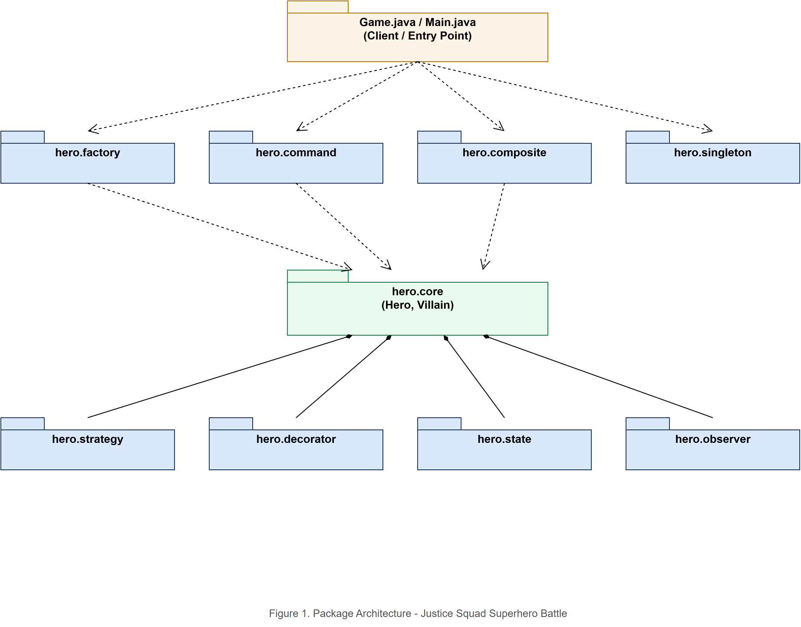

---

## Demo

| Recruit your hero | Equip gear (Decorator) | City threat broadcast (Observer) |
|:-:|:-:|:-:|
| 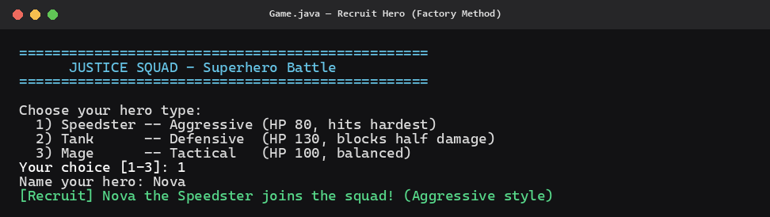 | 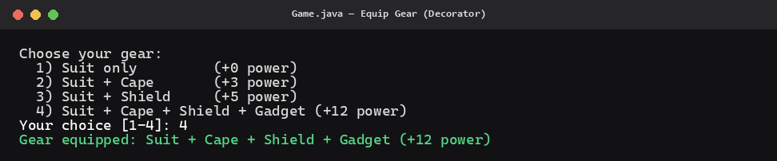 | 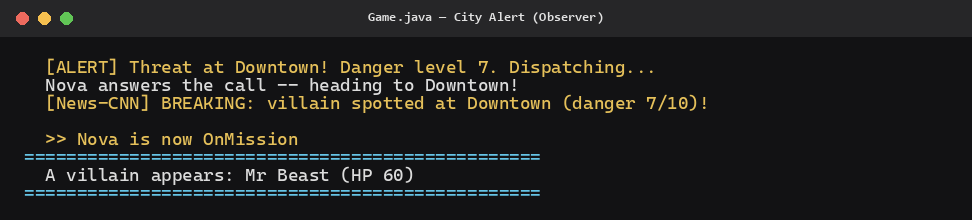 |

| Combat with undo | Victory | Strategy style |
|:-:|:-:|:-:|
| 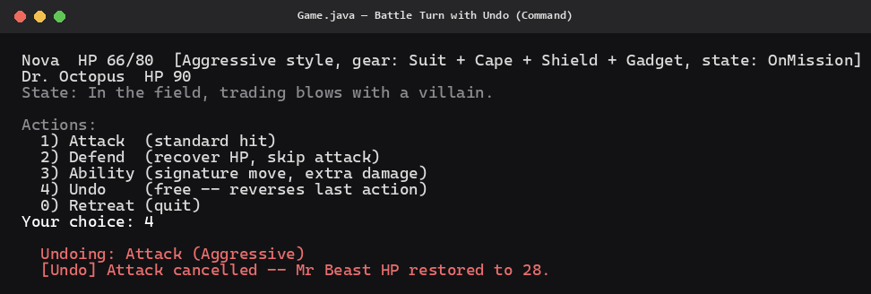 | 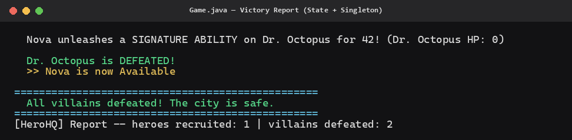 | 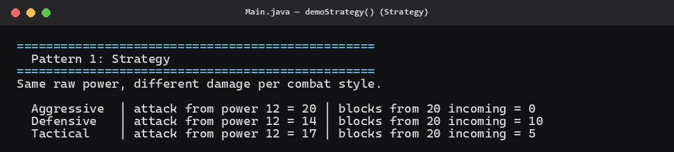 |

---

## How to Run

| Class | What it does |
|-------|-------------|
| `Game` | **Playable** — recruit a hero, equip gear, battle villains turn by turn |
| `Main` | **Demo** — one scripted demo per pattern + integrated battle, no input needed |

**IntelliJ:** open `Game` or `Main` → click Run.

**Terminal (PowerShell):**
```powershell
# compile once
javac --release 8 -d out (Get-ChildItem -Recurse src -Filter *.java).FullName

# run
java -cp out Game   # playable game
java -cp out Main   # pattern demos
```

---

## The 9 Patterns

> Convention: **one pattern = one package** under `src/hero/`

### 1. Strategy — `hero.strategy`

**CombatStyle** defines the algorithm; concrete styles swap in without changing `Hero`.

| Class | Role |
|-------|------|
| `CombatStyle` | Strategy interface |
| `AggressiveStyle` | High damage, low block |
| `DefensiveStyle` | Low damage, high block |
| `TacticalStyle` | Balanced |

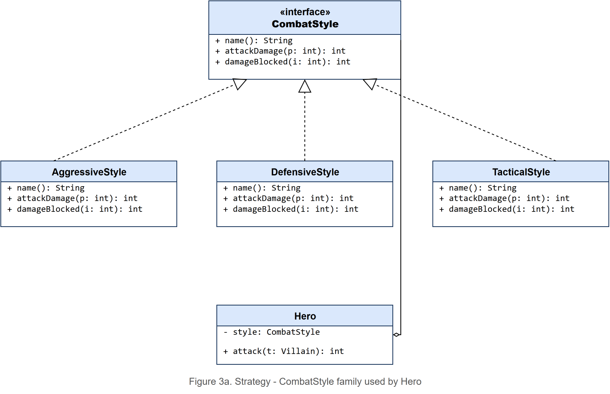

---

### 2. Factory Method — `hero.factory`

`HeroFactory` declares `createHero()`. Each subclass overrides it — no `if/switch` in the creator.

| Class | Role |
|-------|------|
| `HeroFactory` | Abstract creator |
| `SpeedsterFactory` / `TankFactory` / `MageFactory` | Concrete creators |

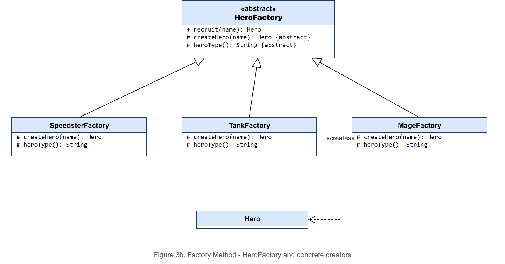

---

### 3. Observer — `hero.observer`

One `broadcastThreat()` call → `Hero` reacts AND `NewsReporter` files a story. Same event, different reactions.

| Class | Role |
|-------|------|
| `ThreatSubject` | Subject interface |
| `AlertSystem` | Concrete subject |
| `AlertObserver` | Observer interface |
| `Hero` / `NewsReporter` | Concrete observers |

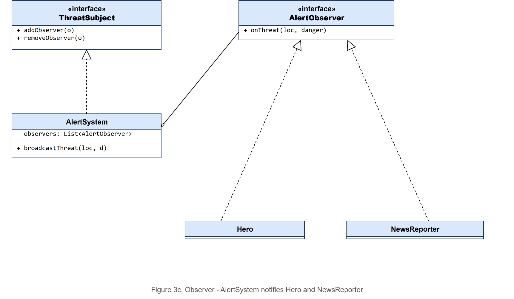

---

### 4. Decorator — `hero.decorator`

Gear stacks at runtime: `GadgetUpgrade(ShieldUpgrade(CapeUpgrade(BasicGear)))`.

| Class | Role |
|-------|------|
| `Gear` | Component interface |
| `BasicGear` | Concrete component |
| `GearUpgrade` | Abstract decorator |
| `CapeUpgrade` / `ShieldUpgrade` / `GadgetUpgrade` | Concrete decorators |

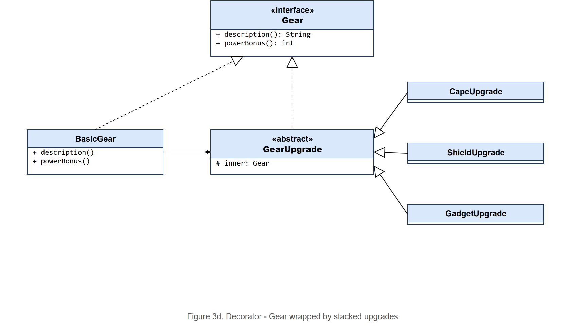

---

### 5. State — `hero.state`

`HeroContext` auto-transitions based on HP — the client never calls `setState()` directly.

| Class | Role |
|-------|------|
| `HeroState` | State interface |
| `HeroContext` | Context — transitions by HP |
| `AvailableState` / `OnMissionState` / `InjuredState` / `RetiredState` | Concrete states |

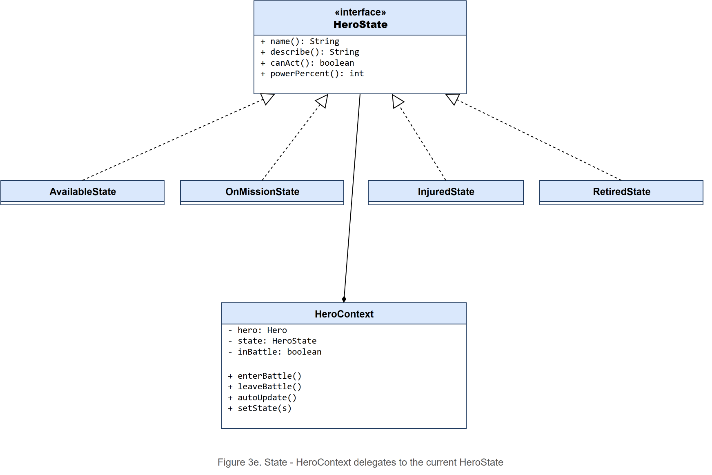

---

### 6. Command — `hero.command`

Every battle action is a `Command` object — enabling **undo** by restoring saved HP values.

| Class | Role |
|-------|------|
| `Command` | Command interface |
| `AttackCommand` / `DefendCommand` / `UseAbilityCommand` | Concrete commands |
| `CommandHistory` | Invoker — stores history for undo |

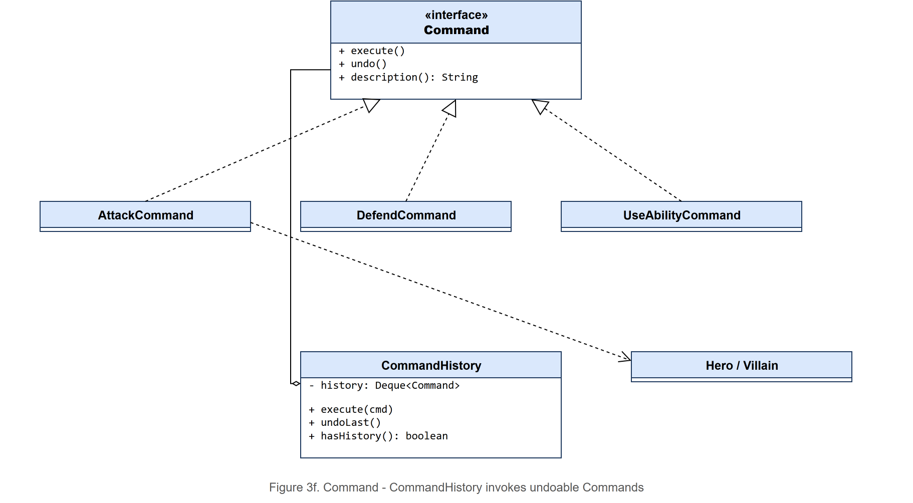

---

### 7. Composite — `hero.composite`

`Team` can contain `HeroMember` leaves or other `Team`s. `awardXp()` recurses the whole tree.

| Class | Role |
|-------|------|
| `RosterComponent` | Component interface |
| `HeroMember` | Leaf |
| `Team` | Composite |

---

### 8. Singleton — `hero.singleton`

`HeroHQ` uses the **holder idiom** — lazy, thread-safe, no synchronized overhead.

| Class | Role |
|-------|------|
| `HeroHQ` | Singleton — tracks all recruits and victories |

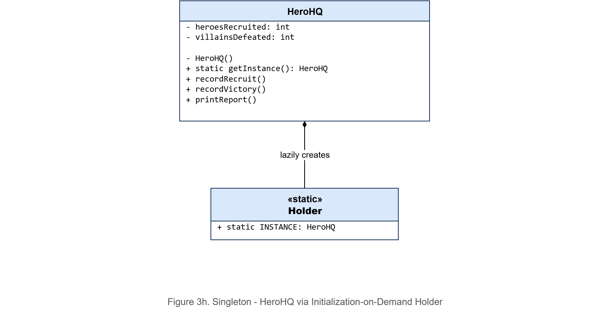

---

### 9. Iterator — `hero.iterator` *(bonus)*

`VillainWave` exposes a `WaveIterator` to step through villain waves without exposing the internal list.

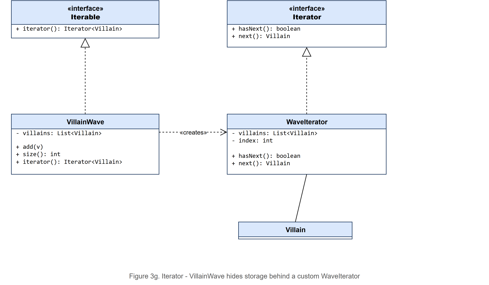

---

## How the Patterns Cooperate

```
Recruit ──[Factory]──> Hero ──[Decorator]──> Hero + Gear
                                │
                         [Observer] AlertSystem broadcasts threat
                                │
                       Battle Turn
                         ├─[Command]     Attack / Defend / Ability + Undo
                         ├─[Strategy]    Damage / block calculation
                         ├─[State]       HP gates damage multiplier
                         └─[Composite]  Team.awardXp() on victory
                                │
                         [Singleton] HeroHQ.recordVictory()
```

### Strategy vs State — the common exam question

| | Strategy | State |
|---|---|---|
| **Who swaps the object?** | Client (you choose Aggressive) | Context itself (HP drops → Injured) |
| **Why?** | Different algorithms for the same task | Different behaviour as object lifecycle changes |
| **Can client set it?** | Yes, that's the point | Technically yes, but shouldn't |

---

## Project Layout

```
src/
├── Game.java              playable turn-based battle
├── Main.java              scripted pattern demos
└── hero/
    ├── core/              Hero.java, Villain.java
    ├── strategy/  [1]     CombatStyle, Aggressive/Defensive/TacticalStyle
    ├── factory/   [2]     HeroFactory, Speedster/Tank/MageFactory
    ├── observer/  [3]     AlertObserver, ThreatSubject, AlertSystem, NewsReporter
    ├── decorator/ [4]     Gear, BasicGear, GearUpgrade, Cape/Shield/GadgetUpgrade
    ├── state/     [5]     HeroState, HeroContext, Available/OnMission/Injured/RetiredState
    ├── command/   [6]     Command, Attack/Defend/UseAbilityCommand, CommandHistory
    ├── composite/ [7]     RosterComponent, HeroMember, Team
    ├── singleton/ [8]     HeroHQ
    └── iterator/  [9]     VillainWave, WaveIterator
```

**37 Java files · 9 packages · Java 8 compatible**

---

## Use Case Diagram

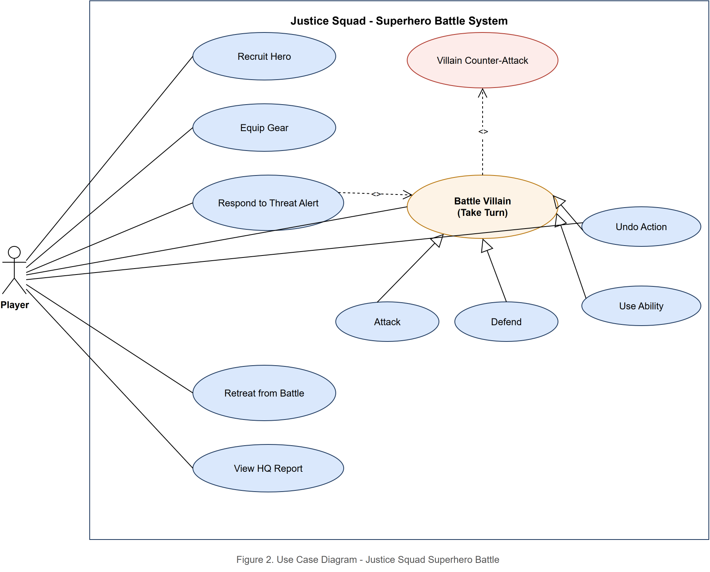

---

*L25020028 · Software Design Pattern Final Project*
